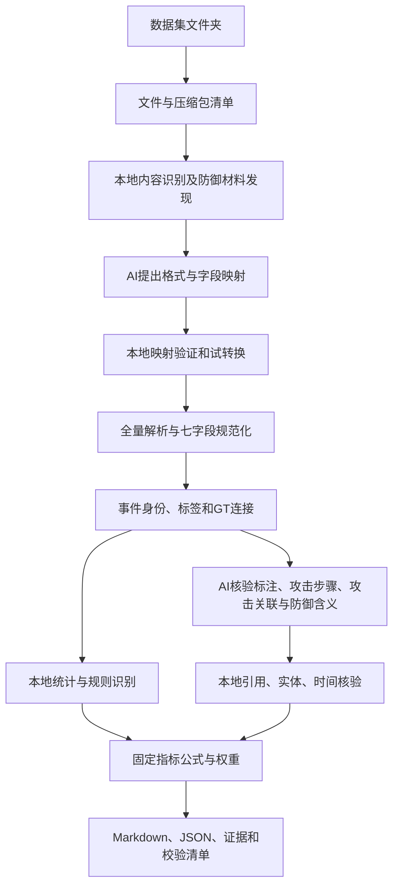

# 从输入到输出的算法说明

本文面向开发与方法审查人员；日常运行只需阅读[使用说明](../USAGE.md)。本文件说明系统实际执行的算法。数值公式的完整定义见[评分规则](SCORING.md)，字段约定见[内部字段说明](INPUT_OUTPUT.md)。程序不从历史评估报告读取待评数据的分数。

## 处理链路

离线或显式提供映射配置时绕过AI映射；离线模式还绕过标注、GT、攻击关联及防御语义判断。对应未核验部分不获分。

## AI和本地计算的职责

| 步骤 | 执行方式 | AI能决定什么 | 本地约束及产物 |
| --- | --- | --- | --- |
| 文件清单、内容探测、防御候选发现 | 本地脚本 | 不调用AI | 文件身份、角色候选、防御类别与来源 |
| 陌生格式识别与字段映射 | AI提出声明式方案 | 文件角色、实际字段路径、枚举映射和有证据的类型常量 | 不接受代码；检查配置、引用、源字段和试转换 |
| 全量解析、身份去重和标签连接 | 本地脚本 | 不调用AI | 完整与不完整事件、连接证据、冲突和缺项 |
| C01—C06 | 本地统计/规则 | 不调用AI | 数量、分母、支持规则和定位 |
| C07 | AI语义判断＋本地核验 | GT步骤叙述被完整/部分支持或证据不足 | 精确引用检查、完整支持结论复核；最终比例本地计算 |
| R01 | 模型语义判断＋本地核验 | 目标记录的标签及全部声明步骤归属是否有依据 | 逐步骤抽样清单、关联上下文、精确引用检查、逐项判断留档 |
| R02—R03 | 本地统计 | 不调用AI | 时间和行为分布、逐参数代入值 |
| A01 | AI语义判断＋本地核验 | 不同战术目标间的依赖是否被限定证据支持 | 候选实体关联、时间和主机校验、精确字段引用 |
| A02 | 本地规则 | 不调用AI | 已确认子技术实现分组 |
| A03、A04 | AI语义判断＋本地核验 | 执行含义、ATT&CK缓解措施归类、结果是否对应执行与声明 | 源文件与记录哈希、动作/目标/时间连接、目录编号、精确引用；本地去重和计算 |
| 数值评分和报告 | 本地脚本 | AI不直接输出分数 | 固定公式、权重、零分原因、最终JSON/Markdown |

所有AI步骤经`ai_transport.py`调用可配置的OpenAI兼容Chat Completions接口。`runtime_config.py`读取独立`.env`中的地址、模型、密钥与兼容参数；通用接口默认不发送厂商私有thinking参数。请求体和接口地址共同计算SHA-256缓存键，原始请求、回复和传输元数据分别留档，密钥只用于认证头。禁用重定向，避免凭据及证据意外转发。JSON模式、温度与token参数可按模型能力调整；无论服务如何配置，本地引用核验和评分公式保持一致。不同模型可能给出不同语义结论，因此比较时应固定模型、服务和协议。缺少用量信息的服务不能靠本系统准确统计token费用。

## 1．文件扫描、解压和角色识别

`archive_input.py`扫描输入目录，跳过开发缓存目录和符号链接。支持的压缩包先在输出目录展开；拒绝绝对路径、父目录穿越、链接、设备及路径冲突。按成员声明大小检查可用空间，预留256MiB后才解压；这只保证解压阶段，不保证后续统计索引所需空间。每个成员写出时计算SHA-256，检查实际字节数。

`input_adapters.py`通过内容形状识别JSON、JSONL、数组JSON、CSV/TSV、XML、包捕获及支持的原生结构。文件名可辅助判断，不能据此赋予整个文件恶意标签。元数据、聚合标签和参考文本不当作原始事件重复计数。

`defense_input.py`在评分前发现告警、策略、动作声明及结果声明。仅文件名命中时保留候选，不等于已确认防御语义。支持的物理锚点通过原始文件位置和哈希核验。默认完整扫描候选文件，不再以100,000条截断；显式限量的开发调用仍会标记不完整，不能声称穷尽动作。

## 2．声明式格式映射

`ai_mapping.py`按格式、已知schema与列集合对文件分组；每组最多采样3条记录。采样对象最多保留40个键，数组最多3项，长字符串截断至400字符，深层对象继续限制长度。文件清单与样本组成可追溯的证据包。

模型返回每组的角色、native/mapping/retain决策、字段路径、枚举映射、时间单位、时钟基准和证据ID。模型不能编造身份、时间和标签；常量仅可用于有样本支持的主体类型、客体类型和操作。

本地编译器要求每组恰好出现一次、引用ID存在、字段路径在样本中存在、值属于允许枚举，不允许把已经识别的数据藏成参考文件。随后用拟议映射试转换：某组没有任何样本满足最小合同，则不接受。最多尝试两次，第二次附带第一次校验错误；仍失败则保留请求、回复与错误并停止。

这种验证能拦截不存在字段和明显结构错误，不能证明模型已正确理解所有字段语义；正式全量扫描仍会暴露样本中未出现的结构。

## 3．全量规范化与事件身份

`event_contract.py`构建固定事件：event_id、event_time、subject_type、subject_id、operation、object_type、object_id，并保留provenance、host、native_type、命令行、路径、标签与GT关联等扩展。

JSON按流式对象/数组解析，XML按事件解析，PCAP按包解析。时间同时记录值、单位与时钟基准；未知单位不猜测，相对时钟不擅自转换为UTC。占位空值、未映射节点类型和操作会产生明确字段错误；不完整事件另存，不静默删除。

每条物理事件的可追踪ID由源内容哈希与定位信息派生。用于去重的原生身份限定在主机/通道范围；没有可靠原生ID时使用物理身份。相同身份不同内容报告冲突，不能把行为内容相同的两次事件合并为一次。身份表使用SQLite，避免把全部事件对象一直放在内存。

CDM事件可能引用尚未出现的节点，因此先扫描节点声明建立主机域内UUID—类型索引，再扫描事件。发生节点类型冲突时保留错误，不臆造类型。该节点索引及标签索引仍可能占用较多内存。

## 4．标签、实例和GT步骤连接

`ingest.py`分别建立事件ID标签、节点上下文标签和物理锚点索引。

- 物理标签：解析相对路径、字节偏移和长度，读取原字节并验证记录SHA-256。范围重叠和GT未覆盖的有效字节单独报告。
- ID标签：按明确事件ID连接，同时考虑文件和主机作用域；ID在多个位置含糊时不扩散标签。
- 内嵌标签：保留原值，通过明确映射转为标准状态；数字标签必须由配置说明含义。
- 节点标签：作为节点上下文保存，不把节点周围全部事件自动认定恶意。
- GT结构：读取实例名称、步骤ID及叙述，建立事件—步骤—实例关系。步骤关联只说明能定位，不证明其叙述完整成立。

原始标签、标准标签、连接来源、未匹配行和冲突全部保留。C02统计实例关联，C03统计明确标签覆盖，R01按步骤抽查关联标注并补充标签样本，三者分母不同。

## 5．本地覆盖率与技术规则

`technique_rules.py`依据实际操作、可执行文件及参数、类型化目标路径等条件识别可观察过程。只有通过恶意归因且字段完整的记录，其支持命中才能进入C04/C05；其余记录保留为候选。执行命令通常证明调用或尝试，不证明攻击成功。

命中输出规则ID、技术/父技术/战术ID和原始定位。父技术去重后计算C05的30项饱和曲线；战术按15项容量计算C04。无规则支持的技术不会被模型随意补齐。

C06把完整事件投影为类型三元组，与冻结35项词表求交；同时保留所有实际三元组及频次。A02则只看恶意归因、支持规则命中的父技术，统计其中出现多个不同子技术实现的比例，不把IP或文件名替换算作变种。

## 6．GT语义支持核验

`ai_steps.py`对每个步骤选择最多6种不同原生事件类型的记录；字节定位可用时回读原始记录并重新核验哈希。证据包包括GT叙述、规范化字段、受长度限制的原始字段和来源位置，每批最多4步。

模型只能返回supported、partial、insufficient及精确字段引用。验证器检查步骤覆盖、记录ID、字段路径和值，禁止把标签或步骤ID本身作为行为证据；自认存在缺失声明却返回supported的答案被拒绝。被判完整支持的步骤，基于引用记录再做一次限定声明审查。

每个实例的完整支持步骤比例形成C07。无证据、部分支持和被拒绝项不获确认分。模型不输出数值分数；第二次模型检查也不是独立的事实证明。

## 7．标注语义检查

`annotation_semantics.py`执行R01。建立全部GT步骤目录，流式扫描规范化记录，按步骤及未关联步骤的标签类别分别维护固定哈希最小样本池；默认各池10条。总体计数覆盖全量，模型只看抽中记录与限定上下文。同一事件跨步骤去重后仅检查各组抽中的归属，不把整个良性总体送往模型。

上下文使用临时SQLite实体/主机/时钟/时间索引，为抽中目标寻找前后300秒内最近3条相关记录。索引在输出侧创建并在结束后清理。源文件、字节定位和规范化文件指纹仍校验；样本缺少字段或标签冲突不会被其他好样本替换。

每批最多4个目标、8项归属；单目标归属过多时拆批合并。模型返回标签判断和步骤归属判断，本地检查精确引用与覆盖。每步关联样本全部通过才确认该步骤；无日志步骤仍在分母。无GT步骤时按标签样本支持率评分；未关联步骤的标签在有GT时仅作诊断。逐条判断与逐步骤样本范围都保存，不能把样本结果当全量真值。

`annotation_semantics/plan.json`保存抽中数量、总体和请求批数；`evidence.json`保存抽样规则、总体计数与证据；`review.json`保存逐记录和逐步骤结果；`progress.json`与终端每10批更新进度和当前阶段ETA。`ai/`保留每批请求、回复、校验及缓存。抽查协议加入请求缓存键，旧全量语义回复不直接套用到新样本。输入和模型不变时可恢复原运行，复用已解析输入和未改变的请求。

字段截断、上下文不足与来源不可查时保留原因并不得分；全局分数仍要求全部输入解析完成。R01不复用C07的步骤结论。抽样配置见维护文档。

## 8．时间与行为统计

`authenticity.py`按采集来源、主机、时钟域分组，流式存入SQLite并按时间排序，生成1/10/60秒窗口。零事件区间压缩表示，避免对极长空白逐秒展开；分位数从计数分布求得，不要求把全部秒值展开成列表。

R02使用平均EPS、P95 EPS、P95/(P50+1)及零事件秒比例。速率和波动进入log(1+x)空间，与冻结THEIA参考分别作缓降高斯比较；三个家族等权，再按组内可用时间事件数加权。

R03统计完整事件的主体—操作—客体比例。类别取待评与参考的并集，权重为双方占比平均值；未在参考出现的类别仍参与。每类比例代入高斯函数，组间按完整行为记录数加权。

冻结参考由THEIA完整非空小时的特征拟合：中心为中位数、容忍范围覆盖q10—q90、尺度使用MAD和显式缓降下限。边界不完整小时不参与拟合。仓库只携带必要聚合参数、拟合信息和源哈希，不携带原始事件或样例数据。源哈希重合时记录自参考状态，不把参考对自身的分数冒充独立验证。

## 9．多阶段关联与防御证据

A01先从每步最多3条恶意归因证据中，枚举跨步骤、同主机与时钟域、时间递增且共享类型化实体的候选边；最多向模型提供100条候选，单实例最多32步。模型判断候选是否连接不同战术目标并具有合理依赖，不因仅同主机或时间相邻而确认。脚本重新检查端点步骤、精确引用、实体交集、战术差异与时间顺序。确认合格子链的实例进入分子。

A01评估有证据的关联依赖，不证明某步骤是攻击成功的必要条件。A02按已确认父技术下的不同子技术统计实现变种，不使用模型另猜实现方式。

`defense_semantics.py`负责A03/A04。先按action_id归并全部声明，按固定哈希顺序抽查最多40个唯一动作。执行与结果ID必须唯一解析为有效规范化事件，回读声明和日志原文，检查源文件与记录哈希、同一动作编号、目标和可比较的主机/时间。每动作最多4条执行引用，每动作最多4份结果声明、每份最多4条结果引用；无法定位或证据截断的部分保留原因。

每批最多4个动作交给模型，附带44项冻结目录的编号、名称、官方出处、候选规则及实际证据。模型逐动作返回执行判断、最多3项缓解措施归类及结果判断，每项有理由和原文字段引用。候选规则不是结论，目录名称也不是实施证明。A03允许完整目录内的措施归类，M1055“无需缓解”不属于执行，不计数。

本地验证精确字段值，拒绝用标签、编号、措施名、executed=true等声明代替行为。执行判断需要目标命令或操作与对象；结果确认还要引用原始结果字段并与实际执行对应，时间不能早于执行，明确失败不能被解释成成功。失败结果有证据仍能计入A04。模型不输出分数，脚本按去重措施数/44计算A03，按语义及引用均通过的样本动作数/全部抽中动作数计算A04，抽中但未核验的不从分母排除；未抽中不当作错误。A03仅统计样本内已证实种类。

输出在`adversarial/defense_semantics/`：`evidence.json`保留目录、选择范围、声明、原文和候选连接；`review.json`保留每动作判断与本地错误；`report.md`为中文明细。完整请求、响应和每批本地检查保存在共用`ai/`目录，精确请求可复用缓存。离线时不回退旧规则得分；防御清单未扫完时不能确认抽样总体。目录分类能力不代表任意厂商原始格式已适配。

## 10．合成、留痕与恢复

`quality_summary.py`把内部证据量统一投影为C01—C07、R01—R03、A01—A04的公开分数。缺少可确认贡献记0，已确认部分保留；所有维度固定分母，不重新分配权重。全部扫描完成后才生成数据集总分。

模型请求按完整请求体和接口地址计算SHA-256，相同请求命中本地回复时不再次联网；服务端缓存命中token与本地缓存是两个概念。`ai/usage.json`记录请求来源和API返回用量，本地复用可能携带原用量，不能把所有记录机械累加为本轮账单。API密钥只出现在请求认证头，不保存到审计文件。

`--resume`核验输入路径、已记录的源身份和防御材料后复用阶段结果；`--refresh-gt`保留旧GT判断并重新核验，相同请求仍可使用缓存。改变输入、映射或统计协议时应使用新的输出目录，不能把不同协议的缓存混为一轮。

最终检查记录/标签分区、全量状态与评分公式，并生成产物SHA-256清单。请求、回复和统计证据可复查；这些检查保证过程可追溯，不保证模型的全部语义判断正确。
